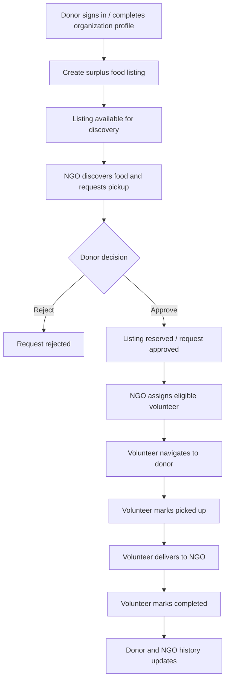
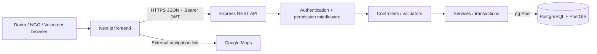
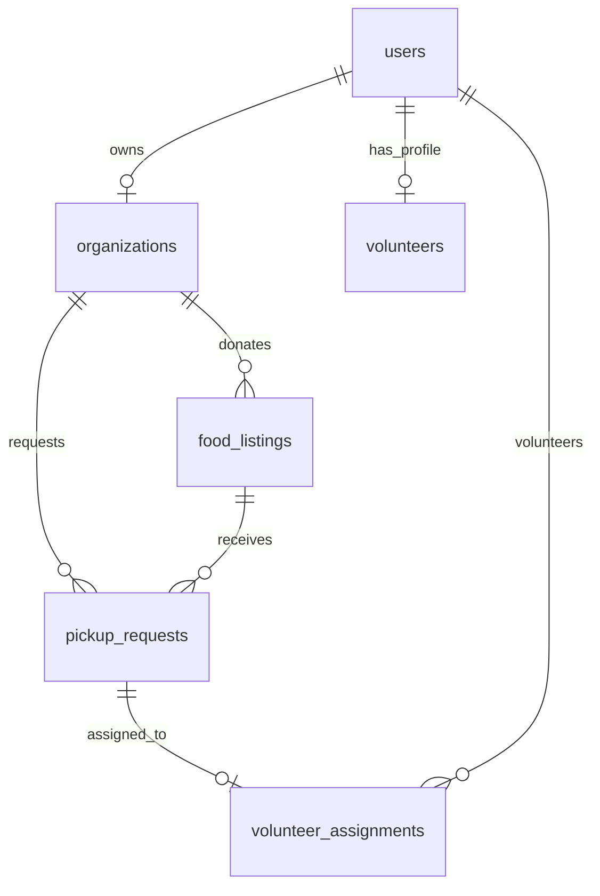

<div align="center">

# 🌿 ZeroWaste
### Rescue Food. Nourish Communities. Reduce Waste.

**A location-aware food rescue and redistribution platform connecting food providers, NGOs and delivery volunteers.**

[](https://nextjs.org/) [](https://react.dev/) [](https://expressjs.com/) [](https://www.postgresql.org/) [](https://tailwindcss.com/)

**[Live Frontend](https://food-rescue-woad.vercel.app)** · **[API Health](https://zerowaster-backend.vercel.app/api/v1/health)** · **[Source Repository](https://github.com/maloodhairyaraj-eng/Food_Rescue)**

> Hackathon prototype / educational demonstration. Food safety, organization identity, and operational reliability must be assessed before real-world use.

</div>

---

## 📚 Contents

1. [The problem and our solution](#-the-problem-and-our-solution)
2. [Key capabilities](#-key-capabilities)
3. [End-to-end workflow](#-end-to-end-workflow)
4. [Technology stack](#-technology-stack)
5. [Architecture](#-architecture)
6. [Repository structure](#-repository-structure)
7. [Prerequisites](#-prerequisites)
8. [Local setup — step by step](#-local-setup--step-by-step)
9. [Database setup and schema](#-database-setup-and-schema)
10. [Environment variables](#-environment-variables)
11. [API reference](#-api-reference)
12. [User roles and permissions](#-user-roles-and-permissions)
13. [Testing and demo walkthrough](#-testing-and-demo-walkthrough)
14. [Deployment with Vercel and Supabase](#-deployment-with-vercel-and-supabase)
15. [Troubleshooting](#-troubleshooting)
16. [Security and data handling](#-security-and-data-handling)
17. [Implementation status and limitations](#-implementation-status-and-limitations)
18. [Future roadmap](#-future-roadmap)
19. [Demo credentials for all three roles](#-demo-credentials-for-all-three-roles)
20. [Team, contributions and license](#-team-contributions-and-license)

---

## 🌍 The problem and our solution

Restaurants, caterers, hostels and other food providers can have usable surplus food while NGOs and community organizations need timely access to it. Traditional coordination through calls or messages is difficult to scale: food is perishable, pickup windows are short, and donors lack visibility into what happens after collection.

**ZeroWaste** digitizes the rescue lifecycle. A donor publishes surplus food and its pickup window; an NGO discovers suitable listings and requests a pickup; the donor approves or rejects; the NGO assigns a volunteer; and the volunteer records pickup and completion. The dashboards reflect persisted backend data rather than treating each portal as an isolated mockup.

### Project goals

- Reduce avoidable food waste by enabling timely discovery and collection.
- Give NGOs visibility into nearby available food and pickup requests.
- Support controlled donor approval and volunteer assignment.
- Maintain traceable listing, request and assignment statuses.
- Demonstrate geospatial discovery using PostgreSQL + PostGIS.
- Make the experience usable from three role-specific dashboards.

## ✨ Key capabilities

| Area | Functionality |
| --- | --- |
| Authentication | User registration, login, JWT-based access and role-based routing |
| Donor portal | Organization profile, create food listings, review and approve/reject incoming pickup requests, cancel listings, see statuses |
| NGO portal | Nearby food discovery, pickup requests, request history, volunteer selection/directory integration, impact summaries |
| Volunteer portal | View assignments, update pickup/delivery status, open Google Maps directions without a Maps API key |
| Spatial data | Latitude/longitude stored using PostGIS geography; proximity-based food discovery |
| Data consistency | PostgreSQL transactions, validation, ownership checks and status constraints |
| Onboarding | Hackathon mode is designed for NGO and donor participation without manual admin approval; confirm latest deployed code enforces this |
| Deployment | Separate Vercel frontend and Express API projects with hosted Supabase PostgreSQL |

> **Implementation note:** Features were developed across multiple local integration phases. Verify that the branch submitted to judges includes the latest directory, availability, impact and theme updates. Some UI areas may still be prototypes; see [Implementation status](#-implementation-status-and-limitations).

## 🔄 End-to-end workflow



**Key lifecycle values:**

- Food listing: `available`, `reserved`, `picked_up`, `completed`, `expired`, `cancelled`.
- Pickup request: `pending`, `approved`, `rejected`, `cancelled`, `completed`.
- Volunteer assignment: `assigned`, `picked_up`, `completed`, `cancelled`.

These status values come from the supplied PostgreSQL schema. An additional legacy `pickup_assignments` table uses a different lifecycle; the current volunteer workflow uses `volunteer_assignments`.

## 🧰 Technology stack

| Layer | Technology | Purpose |
| --- | --- | --- |
| Web frontend | Next.js 16, React 19 | Role-specific UI and routing |
| Styling | Tailwind CSS 4, Lucide icons | Responsive dashboards and consistent design |
| API | Node.js, Express 5 | REST endpoints and application orchestration |
| Authentication | `bcrypt`, `jsonwebtoken` | Password hashing and signed access tokens |
| Authorization | Role/permission middleware | Restrict operations by role and ownership |
| Validation | `express-validator` | Validate incoming API payloads |
| Database | PostgreSQL | Persistent transactional data |
| Geospatial | PostGIS | Store points and support nearby searches |
| Hosting | Vercel | Next.js frontend and Express serverless API |
| Managed DB | Supabase | Hosted PostgreSQL and extensions |
| Navigation | Google Maps directions URLs | Open turn-by-turn navigation without paid Maps API integration |

### Visual identity

**Emerald Night**: emerald `#2F5A44`, antique gold `#D4A373`, silk beige `#F1E3D3`, emerald deep `#244A37`, emerald soft `#4A7A62`. The shared Tailwind tokens live in `frontend/app/globals.css`. This theme is a visual design choice, not a dependency of the backend.

## 🏗 Architecture



**Separation of concerns:** frontend handles user interaction; Express handles validation, authentication, authorization and business rules; PostgreSQL is the source of truth. The frontend never connects directly to PostgreSQL and must never contain DB credentials.

## 🗂 Repository structure

```text
Food_Rescue/
├── backend/
│   ├── api/index.js                 # Vercel function adapter, if present
│   ├── src/
│   │   ├── app.js                   # Express app and route registration
│   │   ├── config/                  # Database and permission configuration
│   │   ├── controllers/             # HTTP request/response handlers
│   │   ├── middleware/              # Authentication and authorization
│   │   ├── routes/                  # REST endpoint definitions
│   │   ├── services/                # Business logic and SQL queries
│   │   ├── validators/              # Request validation
│   │   └── utils/                   # JWT, mappers and eligibility helpers
│   ├── package.json
│   └── vercel.json                  # If serverless deployment is configured
├── frontend/
│   ├── app/                         # Next.js pages, layout and globals.css
│   ├── components/
│   │   ├── auth/
│   │   ├── ngo/
│   │   ├── restaurant/
│   │   └── volunteer/
│   ├── lib/api/                     # API client and response types
│   ├── package.json
│   └── next.config.ts
└── README.md
```

This tree summarizes paths shared during development; inspect the submitted branch for the precise filenames. SQL migrations may be kept in the backend's migration directory or supplied separately.

## ✅ Prerequisites

- Git
- Node.js compatible with Next.js 16 (Node.js **20.9+**; a current LTS version is recommended)
- npm
- PostgreSQL with PostGIS and pgcrypto **or** a Supabase PostgreSQL project
- Two terminal windows (backend and frontend)
- Optional: pgAdmin or `psql` for database setup

For Windows, run commands below in **PowerShell**. Linux/macOS users can adapt the shell commands.

## 🚀 Local setup — step by step

### 1. Clone the repository

```powershell
git clone https://github.com/maloodhairyaraj-eng/Food_Rescue.git
cd Food_Rescue
```

If you are working on a specific tested hackathon branch, check it out before installing dependencies:

```powershell
git branch -a
git switch YOUR_TESTED_BRANCH
```

### 2. Install backend dependencies

```powershell
cd backend
npm ci
```

If `npm ci` reports a missing or out-of-sync lockfile, use the package manager and lockfile actually committed to the repository; do not delete the lockfile as a first fix.

### 3. Configure backend environment

Create `backend/.env` from the [example below](#-environment-variables). Set local PostgreSQL credentials or Supabase pooler credentials, a long random JWT secret, and the frontend origin.

Generate a random JWT secret in PowerShell:

```powershell
$bytes = New-Object byte[] 64
$rng = [System.Security.Cryptography.RandomNumberGenerator]::Create()
$rng.GetBytes($bytes)
$rng.Dispose()
[Convert]::ToBase64String($bytes)
```

The JWT utility shared during development requires `JWT_SECRET` to contain **at least 64 characters**. Never commit or publish the generated value.

### 4. Initialize the database

Follow [Database setup and schema](#-database-setup-and-schema) **before** attempting login or food discovery. An empty database will not work.

### 5. Start the backend

Inspect the available scripts:

```powershell
npm run
```

Run the repository's configured development/start script (for example, `npm run dev` or `npm start` if listed). **Do not assume `npm test` exists:** it was absent from one shared local backend package configuration.

Check the API in another terminal:

```powershell
Invoke-RestMethod http://localhost:5000/api/v1/health
Invoke-RestMethod http://localhost:5000/api/v1/health/database
```

Expected: successful HTTP responses; the database health route must be able to execute its PostGIS check.

### 6. Install frontend dependencies

Open a **second** PowerShell terminal:

```powershell
cd Food_Rescue\frontend
npm ci
```

Create `frontend/.env.local`:

```dotenv
NEXT_PUBLIC_API_BASE_URL=http://localhost:5000/api/v1
```

This URL is public browser configuration, not a secret. For local development, it points to your local Express API.

### 7. Start the frontend

```powershell
npm run dev
```

Visit **http://localhost:3000**. Register or sign in, then navigate to the role-specific dashboard.

### 8. Verify a production build

```powershell
npx tsc --noEmit
npm run build
```

The `frontend/package.json` scripts shared during development are `dev: next dev`, `build: next build`, `start: next start`, `lint: eslint`. Use `npm run lint` if that script is present and correctly configured.

## 🗄 Database setup and schema

### Tables and relationships

| Table | Main responsibility |
| --- | --- |
| `users` | Login identities, roles, bcrypt hashes and account activation |
| `organizations` | Donor/NGO profiles, owner, address, location and verification state |
| `food_listings` | Surplus food, quantity, type, expiry, pickup window, donor and location |
| `pickup_requests` | NGO requests, quantity, decision and status |
| `volunteers` | Volunteer profile, location, availability and vehicle type |
| `volunteer_assignments` | Current pickup/delivery assignment lifecycle |
| `pickup_assignments` | Legacy/alternate assignment model in supplied schema |
| `pgmigrations` | Migration bookkeeping |



**Important constraints in the supplied schema:** positive food quantity; valid pickup and expiry windows; full-listing pickup quantity enforced by a trigger; one organization per owner; one volunteer profile per user; unique active reservation rules; one active assignment per volunteer; and status/timeline checks. Spatial locations use `geography(Point,4326)` with GiST indexes.

### Recommended initialization

1. Create an **empty** PostgreSQL database (or a new Supabase project).
2. Enable `postgis` and `pgcrypto`.
3. Run the project's SQL migrations **in order**, or import the supplied schema-only dump into an empty database.
4. If using Supabase, check whether PostGIS and pgcrypto are installed under `extensions` rather than `public`. The provided local schema dump uses `public.geography`; adjust qualifiers deliberately before importing.
5. Run a demo seed only in a **disposable demo database**.
6. Run verification queries before starting the API.

The schema dump provided during development was generated by **PostgreSQL 18.6**. Raw `pg_dump` scripts may contain `\restrict` and `\unrestrict` commands supported by `psql` but not the Supabase SQL Editor; use a SQL-editor-compatible export there.

### Basic verification queries

```sql
SELECT extname, extnamespace::regnamespace AS installed_schema
FROM pg_extension
WHERE extname IN ('postgis', 'pgcrypto');

SELECT table_name
FROM information_schema.tables
WHERE table_schema = 'public' AND table_type = 'BASE TABLE'
ORDER BY table_name;

SELECT COUNT(*) AS users FROM public.users;
SELECT COUNT(*) AS listings FROM public.food_listings;
```

For a Supabase installation with PostGIS under `extensions`:

```sql
SELECT extensions.PostGIS_Version();
```

### Seed data

A separate development seed script created fictional restaurants, NGOs, volunteers, food listings and pickup workflows. Importing the schema **does not** automatically import those accounts. For the test logins, see [Demo credentials](#-demo-credentials-for-all-three-roles). The exact demo accounts and password must be checked in the database actually connected to the backend. The seed is **not** a substitute for migrations.

> **Public demo security:** The credentials below are intentionally published for judges, so these accounts are **not private**. Use an isolated database with fictional records only, no privileged roles, no real personal data, and no production integrations. Rotate or delete demo credentials after judging.

## 🔐 Environment variables

### `backend/.env.example`

```dotenv
NODE_ENV=development
PORT=5000
DB_HOST=localhost
DB_PORT=5432
DB_NAME=YOUR_DATABASE_NAME
DB_USER=YOUR_DATABASE_USER
DB_PASSWORD=YOUR_DATABASE_PASSWORD
DB_SSL=false
JWT_SECRET=REPLACE_WITH_A_SECURE_RANDOM_SECRET_AT_LEAST_64_CHARACTERS_LONG
JWT_EXPIRES_IN=15m
FRONTEND_URL=http://localhost:3000
ORGANIZATION_APPROVAL_REQUIRED=false
```

When using hosted Supabase, take **host, port, database, username and password** from the Supabase **Connect → Session Pooler** connection parameters. `DB_HOST` is the hostname only — **never** include `https://` or `postgresql://` in `DB_HOST`. The pooler username is commonly `postgres.<project-ref>`, not just `postgres`.

`DB_SSL=true` may be required for the hosted connection. Validate certificate trust and the database's PostGIS `search_path`; don't disable TLS verification merely to make a connection succeed.

### `frontend/.env.local`

```dotenv
NEXT_PUBLIC_API_BASE_URL=http://localhost:5000/api/v1
```

For the deployed frontend, replace it with the **public backend** URL ending in `/api/v1`. `NEXT_PUBLIC_` variables are intentionally visible in the browser. **Never** place `DB_PASSWORD` or `JWT_SECRET` in the frontend.

> `.env`, `.env.local` and all real secrets must be excluded from Git. Keep only placeholder `.env.example` files under version control.

## 📡 API reference

**Base URL (local):** `http://localhost:5000/api/v1`  
**Base URL (deployed example):** `https://zerowaster-backend.vercel.app/api/v1`

Most private routes require:

```http
Authorization: Bearer <access_token>
Content-Type: application/json
```

| Method | Route | Purpose |
| --- | --- | --- |
| `GET` | `/health` | API health |
| `GET` | `/health/database` | Database/PostGIS health |
| `POST` | `/auth/register` | Create user |
| `POST` | `/auth/login` | Obtain JWT |
| `GET` | `/auth/me` | Authenticated user profile (confirm current route) |
| `POST` | `/organizations` | Create donor/NGO organization |
| `GET` | `/organizations/me` | Get own organization |
| `PATCH` | `/organizations/:id` | Update organization |
| `POST` | `/food-listings` | Create donation |
| `GET` | `/food-listings/mine` | Donor's listings |
| `GET` | `/pickup-requests/mine` | NGO pickup request history |
| `GET` | `/pickup-requests/incoming` | Donor's incoming requests (confirm mounted route) |
| `POST` | `/pickup-requests/:id/assign` | Assign volunteer to approved pickup (confirm mounted route) |
| `GET` | `/volunteer/assignments` | Volunteer assignments |
| `GET` | `/volunteer/assignments/:id` | Assignment detail |
| `PATCH` | `/volunteer/assignments/:id/status` | Pickup/delivery status |
| `GET` | `/volunteer/directory` | NGO volunteer directory, if deployed |
| `GET` | `/volunteer/availability` | Own availability, if deployed |
| `PATCH` | `/volunteer/availability` | Update own availability, if deployed |

**Important:** This is a practical API overview based on the shared route/controller excerpts and integration work, **not an automatically generated OpenAPI specification**. Some exact paths and HTTP methods must be confirmed against the final committed `backend/src/routes` files. Avoid treating provisional paths as guaranteed.

### Example: login

```powershell
$body = @{
  email = 'YOUR_TEST_ACCOUNT_EMAIL'
  password = 'YOUR_TEST_ACCOUNT_PASSWORD'
} | ConvertTo-Json

Invoke-RestMethod `
  -Uri 'http://localhost:5000/api/v1/auth/login' `
  -Method POST `
  -ContentType 'application/json' `
  -Body $body
```

Never publish the returned access token.

### Example: volunteer availability

```json
{
  "isAvailable": true
}
```

### Typical API response

```json
{
  "success": true,
  "message": "Assignments retrieved successfully",
  "data": { "assignments": [] }
}
```

Validation errors may include an `errors` array with rejected field names. Read that array rather than relying on a generic “Validation failed” message.

## 👥 User roles and permissions

| Role | Main actions |
| --- | --- |
| **Donor** | Manage own organization, publish/cancel food, approve/reject pickup requests |
| **NGO** | Discover food, request pickup, manage own pickup history, assign volunteers |
| **Volunteer** | View own assignments, update delivery status and availability |


**Hackathon onboarding policy:** Manual NGO/restaurant approval is not part of the intended three-role experience. Earlier code versions still included approval-related fields, admin routes and checks; verify that the submitted commit has removed enforcement in the frontend and backend. A registered organization is not independently identity-verified. Donor approval of an individual NGO pickup request is a separate, necessary workflow step.

The server must enforce ownership and permission checks independently of any disabled or hidden frontend buttons.

## 🧪 Testing and demo walkthrough

### Automated and static checks

```powershell
# Frontend
cd frontend
npx tsc --noEmit
npm run build
npm run lint

# Backend (from repository root)
cd ..\backend
npm run
```

Run `npm test` **only if** the backend `package.json` defines a `test` script. Syntax-only checks do not validate business rules or database behavior.

### Manual acceptance checklist

- [ ] `/health` and `/health/database` return HTTP 200.
- [ ] Donor, NGO and volunteer can sign in and reach their own dashboards.
- [ ] New donor and NGO registration creates required organization profiles.
- [ ] Volunteer registration creates a `volunteers` profile.
- [ ] Donor creates a listing with valid quantity, location and future pickup window.
- [ ] NGO can discover and request that listing.
- [ ] Donor can approve/reject the incoming request.
- [ ] NGO assigns an available, non-busy volunteer.
- [ ] Volunteer can open Google Maps pickup/delivery links.
- [ ] Volunteer marks `picked_up`, then `completed`.
- [ ] Listing, pickup and assignment statuses agree in PostgreSQL.
- [ ] Pending-status demo organizations can participate without administrator intervention; unauthorized roles and non-owners remain blocked.
- [ ] Refreshing dashboards retains server-backed state.
- [ ] Frontend TypeScript, ESLint and production build pass.

### Recommended hackathon demo (3–5 minutes)

1. Explain the food-waste problem and introduce the three roles.
2. Sign in as a donor and create a short-window surplus listing.
3. Sign in as an NGO and show nearby food discovery and pickup request.
4. Return to donor portal and approve the request.
5. Assign an available volunteer and show the assignment in the volunteer portal.
6. Open navigation, mark pickup and completion.
7. Return to donor and NGO dashboards to show updated statuses and history.
8. Explain PostGIS matching, JWT permissions and database transaction safeguards.

Use **clearly labeled fictional demo data**. Don't imply that demo quantities represent verified real-world impact.

## ☁️ Deployment with Vercel and Supabase

Two Vercel projects can deploy from the same repository:

| Project | Root directory | Runtime |
| --- | --- | --- |
| Frontend | `frontend` | Next.js |
| Backend | `backend` | Express on Vercel Functions |

### 1. Supabase

- Create a Supabase PostgreSQL project.
- Enable PostGIS and pgcrypto; import the correct migrations/schema and optionally a private demo seed.
- Obtain **Session Pooler** connection parameters.
- Confirm the SQL Editor can query the application tables and PostGIS functions.

### 2. Backend Vercel project

- Import the GitHub repository, choose the tested deployment branch and set root directory to `backend`.
- Use the backend's committed Vercel function adapter/routing configuration (for example, `api/index.js` exporting the Express app without calling `listen`).
- Set `DB_HOST`, `DB_PORT`, `DB_NAME`, `DB_USER`, `DB_PASSWORD`, `DB_SSL`, `JWT_SECRET` and `FRONTEND_URL`. If your submitted backend still reads `ORGANIZATION_APPROVAL_REQUIRED`, set it to `false` until that legacy switch is removed.
- Deploy, then verify `/api/v1/health` and `/api/v1/health/database`.

### 3. Frontend Vercel project

- Import the **same** repository with root directory `frontend` and framework preset **Next.js**.
- Set `NEXT_PUBLIC_API_BASE_URL=https://YOUR_BACKEND_DOMAIN/api/v1` as public configuration.
- Leave **Output Directory** at the Next.js default; don't manually override it to `.next`.
- Deploy and confirm the login page loads.

### 4. CORS and final checks

- Set backend `FRONTEND_URL` to the **exact** frontend origin, such as `https://food-rescue-woad.vercel.app` — not the backend URL.
- Redeploy the backend after environment changes and the frontend after changing `NEXT_PUBLIC_` values.
- Test browser Network requests, authentication, food creation and database persistence.

**Public demo endpoints previously used:** [frontend](https://food-rescue-woad.vercel.app) and [backend](https://zerowaster-backend.vercel.app). These are deployment references, not uptime guarantees.

## 🧯 Troubleshooting

| Symptom | Common cause | Check |
| --- | --- | --- |
| Frontend cannot reach server | Wrong `NEXT_PUBLIC_API_BASE_URL` | Browser Network request URL |
| CORS preflight blocked | Backend `FRONTEND_URL` points to wrong origin | `Access-Control-Allow-Origin` |
| Database health `503` / `ENOTFOUND` | `DB_HOST` includes `https://` or wrong host | Host must be hostname only |
| DB password authentication fails | Wrong pooler user/password | Supabase Connect parameters |
| PostGIS function missing | Extension schema/search path mismatch | `extensions.PostGIS_Version()` |
| SQL Editor errors near `\restrict` | `psql` directive pasted into SQL Editor | Use SQL-editor-compatible schema |
| `public.geography` missing | PostGIS installed under `extensions` | Fix schema qualifiers |
| Login `500` | JWT secret invalid or other backend exception | Runtime logs; secret length >=64 |
| Register `400` | Payload violates validator | API Response `errors` array |
| Matching `400`: `Unsupported parameters: path` | Deployment rewrite injected a routing parameter into Express query | Check backend Vercel rewrites and query-parameter forwarding; preserve strict validator |
| Restaurant says “must be verified” | Older frontend guard or backend eligibility check | Review `RestaurantDashboard.jsx`, `food.service.js`, eligibility helper and deployed commit |
| Donation `400` | Wrong quantity, type, dates or coordinates | Compare request body with validator |
| `.next` output missing | Failed build or Vercel output override | `npm run build`; default output directory |
| Volunteer directory empty | No profile rows, availability disabled or stale deployment | SQL + directory endpoint |
| Google Maps link missing | Invalid/null coordinates | Assignment location payload |

When debugging, capture **status code + response body + server log**, but redact passwords, tokens and connection strings.

## 🛡 Security and data handling

- Passwords are stored as bcrypt hashes; never store plaintext passwords.
- JWTs are signed using HS256 with issuer/audience restrictions and a configured expiration (the shared utility defaults to `15m`).
- Protected endpoints require authentication and role/permission checks.
- Server-side validators reject invalid or unsupported fields.
- Database foreign keys, check constraints, indexes and transactions help preserve consistency.
- Restrict organization updates and pickup approvals to their rightful owners.
- Use TLS for production API/database connections and keep secrets in backend-only environment variables.
- Do not expose JWTs, connection strings, Supabase database passwords or real personal data in screenshots, logs or GitHub.
- Reset credentials that have been shared publicly, including demo passwords before public access.
- A demo with instant onboarding is **not** proof of identity verification or food safety compliance.

## 📍 Implementation status and limitations

**Reported as integrated during development:** donor listing management, NGO pickup requests, donor approval/rejection, volunteer assignments, pickup/delivery status, Google Maps navigation, PostgreSQL persistence and the Vercel/Supabase deployment path.

**Verify in the submitted commit:** volunteer directory and availability toggle, History & Impact component, onboarding fixes, complete Emerald Night theme, removal of restaurant/NGO approval gates, Vercel rewrite fixes, and the current status of all dashboard placeholders. Do not mark these complete solely because a local file was edited.

**Known limitations / not to overclaim:**

- The earlier donation creation flow produced a validation error in some tests; re-test the deployed form.
- Secure pickup/delivery OTP verification was discussed but not confirmed implemented.
- CO₂e impact calculations need an explicit, defensible methodology; don't invent values.
- Containers, ratings, notifications and expanded collaboration tools may remain prototype/placeholder modules.
- Public deployment does not imply food-safety certification, verified NGO identity or production SLA.
- Serverless API instances are ephemeral; long-running background jobs need a different execution strategy.
- An automated backend test script was missing in one local configuration; document only tests actually passing on the final branch.

## 🗺 Future roadmap

1. Verified handover codes or QR-based pickup confirmation.
2. Better volunteer matching using distance, availability and vehicle capacity.
3. Food safety metadata, expiry alerts and audit trails.
4. Robust notifications and status-change alerts.
5. Optional, separate identity-assurance process for any future real-world rollout (not required in the hackathon prototype).
6. Documented impact calculations and exportable reports.
7. Improved accessibility, multilingual support and mobile-first workflows.
8. Production monitoring, rate-limit tuning and automated integration tests.

## 🔑 Demo credentials for all three roles

The following **fictional development accounts** were used in the ZeroWaste sample dataset. They are intended for a **disposable judging/demo database**, not real-world operation.

| Role | Demo email | Demo password | Landing page |
| --- | --- | --- | --- |
| **Restaurant / Donor** | `demo.restaurant@zerowaste.example` | `DemoOnly!2026` | `/restaurant` |
| **NGO** | `demo.ngo1@zerowaste.example` | `DemoOnly!2026` | `/ngo` |
| **Volunteer** | `demo.vol1@zerowaste.example` | `DemoOnly!2026` | `/volunteer` |

**Demo URL:** https://food-rescue-woad.vercel.app

> **Availability warning:** These are credentials from the previously discussed demo seed, **not live-tested credentials for the current deployment**. They work only if the corresponding accounts were inserted into the same database as the deployed backend and their bcrypt hashes match the password. The NGO and volunteer addresses should be confirmed against the final seed script before judging. If they do not work, use newly registered test accounts and update this table.

### Judge walkthrough with three accounts

1. **Donor:** Sign in, open **Create Donation**, enter a valid food type, whole-number quantity, future expiry and pickup window, and publish. Donor registration should not require admin verification.
2. **NGO:** Sign in separately, open **Food Requests**, discover the nearby donation, and submit a pickup request. The NGO must have organization coordinates, and the donation must still be available and within the selected radius.
3. **Donor:** Refresh **NGO Collaborations** and approve the specific pickup request. This is a **donation-specific decision**, not NGO account verification.
4. **NGO:** Assign an eligible, available volunteer through the supported pickup assignment flow.
5. **Volunteer:** Sign in, open assigned delivery, follow directions, mark pickup, then completion according to the implemented state machine.
6. **Donor / NGO:** Refresh dashboards to confirm completed statuses and history.

**Recommended demo setup:** Open three different browsers, browser profiles, or devices. Each must use its own account; do not share a JWT between roles. If accessing a Next.js server from other LAN devices, use the host computer's LAN IP instead of `localhost`, and ensure the API URL/CORS origin is configured for that environment.

### Verify the demo accounts in Supabase

This query checks presence and account state **without revealing password hashes**:

```sql
SELECT email, role, is_active
FROM public.users
WHERE email IN (
  'demo.restaurant@zerowaste.example',
  'demo.ngo1@zerowaste.example',
  'demo.vol1@zerowaste.example'
)
ORDER BY role, email;
```

Expect one active record per role. A missing row means that account was not seeded in this database. Never put the real Supabase database password, JWT secret, access tokens or other credentials in this README.

## 🤝 Team, contributions and license

**Team:** Add the final hackathon team name, member names and responsibilities before submission. Do not invent contributor credits.

**Before judging:** Verify the demo logins, confirm the GitHub branch matches both Vercel deployments, check API health/database health, and capture screenshots of the three dashboards. A successful build alone does not prove the end-to-end workflow works.

**Contributing:** Open an issue or pull request describing the change, test it locally, and avoid committing secrets. For a team hackathon submission, designate one tested branch/commit as the judging reference.

**License:** Add a `LICENSE` file if the team chooses an open-source license. Until a license is explicitly provided, do not assume the repository grants reuse rights.

---

<div align="center">

### 🌱 Every rescued meal is an opportunity to make a difference.

**ZeroWaste — built to connect surplus with need.**

</div>
